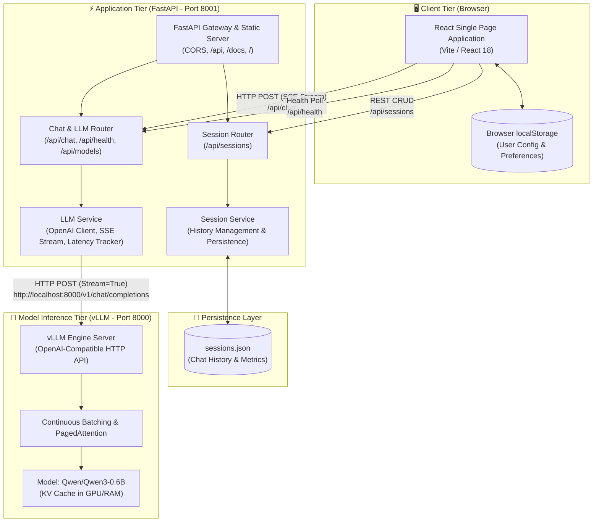
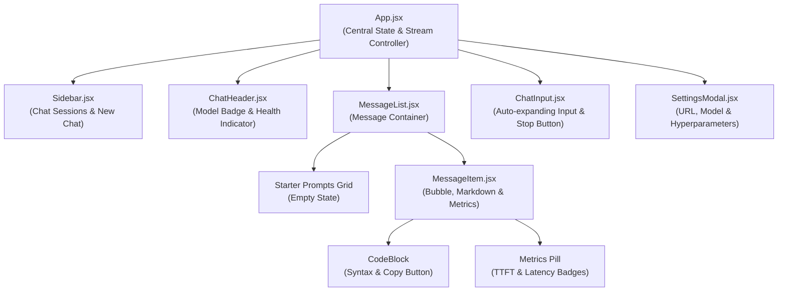
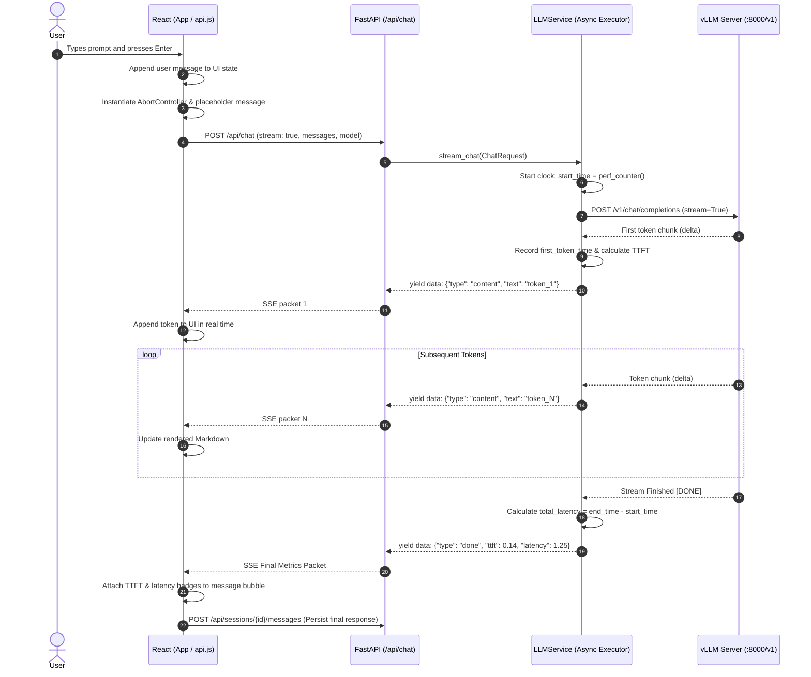
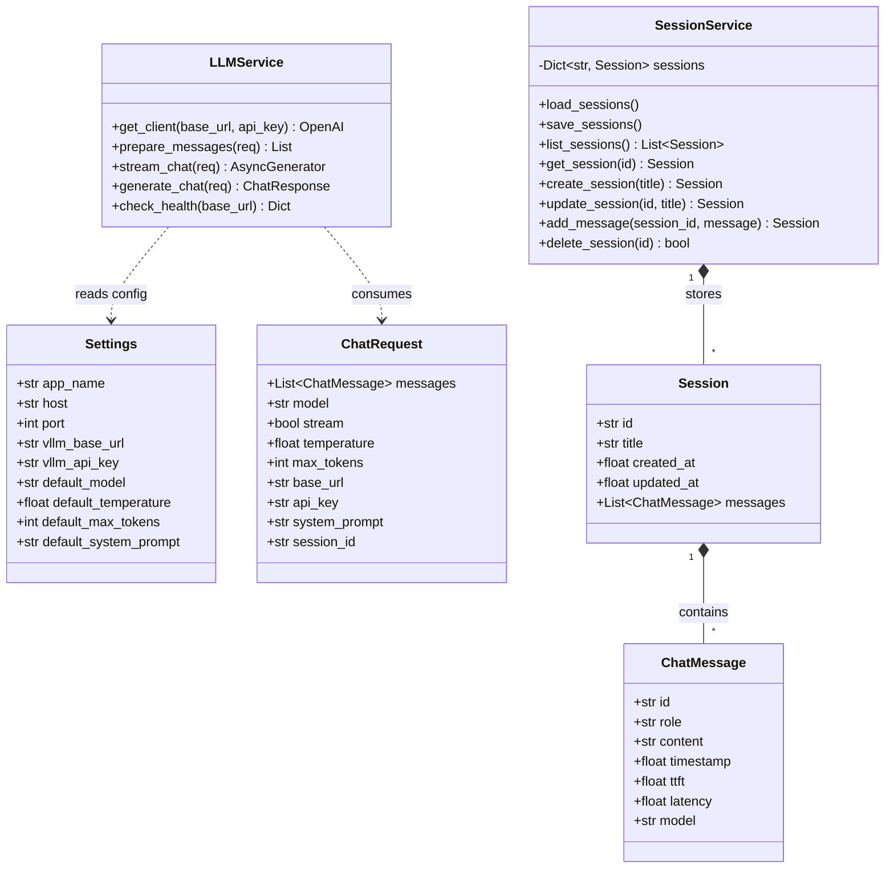

# 📐 KittuBot Architecture Specification (HLD & LLD)

This document provides both the **High-Level Design (HLD)** and **Low-Level Design (LLD)** for the **KittuBot** chat application, illustrating how the React frontend, FastAPI backend, and local vLLM inference engine interact.

---

## 1. High-Level Architecture (HLD)

The High-Level Architecture outlines the system boundaries, major components, network ports, and data stores.

---

## 2. Low-Level Architecture (LLD)

### 2.1 React Component Hierarchy

---

### 2.2 End-to-End Real-Time Token Streaming Sequence

---

### 2.3 Backend Class & Module Architecture

